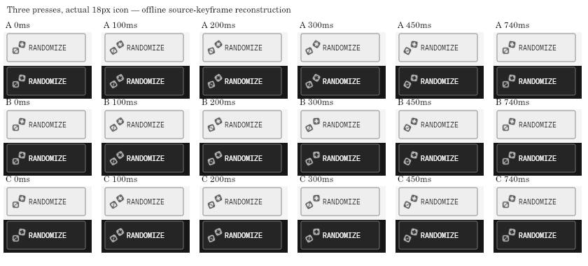

# Separated Randomize dice — November 11, 2026

The two complete 10-unit faces have centers (18, 6) and (6, 18) in the unchanged
24-unit viewBox. The rear retains a 12-degree resting tilt. Both use the existing
thin 1.5-unit currentColor stroke and filled pips (four behind, three in front). The fixed icon slot stays
18px; the label, action hit target and CSS stay unchanged.

Each activation samples four independent values per die: direction, outward
travel (0.6–1.2 units), recoil (3–7 degrees), duration (back 560–660ms, front
600–700ms). Each makes exactly one full turn, with sampled smooth acceleration
and deceleration and a small final recoil. Outward travel follows a smooth
squared sine, returning exactly to zero. Ending at ±360 degrees is visually the
same as the underlying rest, so completion leaves no transform or layout shift.
The randomness is decorative; it is not stored in controls/shares/exports.

Repeated activation reads each die's current computed matrix before canceling
its previous animation. Older completion callbacks cannot clear a replacement.
Hidden pages, page exit and a live reduced-motion preference cancel both.
Reduced motion and unsupported SVG animation show the separated static icon.
Native pointer/keyboard-generated clicks keep the same immediate Randomize path.

## Evidence

The contact sheet reconstructs three actual source-keyframe profiles at 0, 100,
200, 300, 450 and 740ms. The icon is shown at its actual size without aspect
ratio distortion in a representative button context. The SVG is rasterized
natively around the same fill-box centers used by CSS. A temporary 216-frame
sequence also includes three different presses and resting pauses. All source
profiles were checked every 5ms against the existing overflow/padding envelope.
The circumscribed face bounds leave at least 1.32 viewBox units between rotating
faces even before the outward travel. The furthest possible edge, including
stroke and maximum travel, stays inside a 4-unit overflow envelope.

Focused unit coverage tests random extrema, fresh variation, full turns and
restrained recoil, bounds, gap, distinct face responses, fixed slot, rapid matrix
continuity, stale/natural completion, reduced motion/visibility and native click
semantics. The optional `scripts/parameterActionFeedbackSmoke.js` is updated for
per-face capture, the new duration bounds and Enter activation; it was not run.
Final full-suite and exact-head CI results are recorded in the PR.

This is offline source/raster evidence, not native browser timing, live input,
physical touch, screen-reader or subjective owner acceptance. Browser execution
remains restricted; no denied route is retried. The change adds no dependency,
logo asset, bar geometry, export behavior or official brand approval claim.
