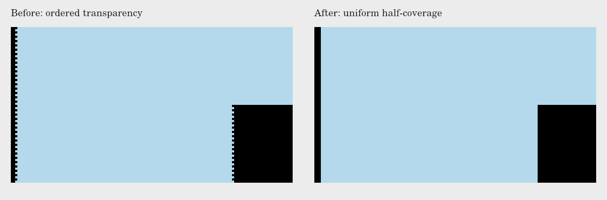

# GIF straight-edge diagnosis and verification

The owner’s Library screenshot is a magnified black Waveform animation over a
light/blue background. Its otherwise vertical edges have repeated teeth;
several other edges remain straight. A still screenshot cannot establish motion
cadence; the original GIF and viewer zoom are not available. The image was
materialized through the current Library helper,
readable bytes verified, and its actual pixels inspected. It is not republished.

The shared waveform geometry already emits exact one-sided discontinuities.
The GIF exporter then replaced partial alpha using a 4 × 4 ordered coverage
mask. At fractional-pixel edges, identical source coverage becomes alternating
opaque/transparent pixels along the edge. Magnification exposes the same teeth
as the supplied screenshot. Native raster/codec comparisons reproduce this
spatial failure independently of browser frame timing or audio.

The default now uses a uniform half-coverage cut. GIF retains one exact ink,
one transparent palette entry, disposal 2 and no matte. Raster edges round at
half coverage, with at most half-pixel boundary displacement; curved/diagonal
edges still have binary-alpha pixel steps. SVG and PNG retain their existing
smooth coverage. Scientific coordinates, official bar geometry, audio and LFO
math, frame planning, cancellation and worker streaming are unchanged.

## Evidence

This generated sheet is an enlarged nearest-neighbor crop of actual decoded
GIF pixels from the repository’s captured export renderer and vendored codec.
It contains original primitive bar geometry and labels, no user screenshot,
external image, replacement identity asset or bundled font. Existing underlying
brand-asset questions are unchanged. The light-blue comparison background is
added only to this review image, never to exports.

Run `node scripts/gifEdgeEvidence.js /tmp/rpi-gif-edge-evidence` in an environment
with optional test-only `@napi-rs/canvas`. No application dependency is added.
It exercises eight phases per case to inspect edges, not full-speed cadence.

- 20 actual GIFs / 160 decoded frames: old and corrected conversion for Waveform
  square and square/pulse, Standard and Large, Bar only and Bar + RPI; plus
  Ticker and Gradient Standard bar-only controls.
- All frames match their prepared renderer pixels after actual codec decoding;
  dimensions, exact palette, transparency, disposal 2 and 40 ms sample delays
  are checked. These sample sequences are not a benchmark of export loop speed.
- Straight plateau interiors in all 64 original Waveform source frames have
  zero row-to-row alpha changes. The ordered conversion adds 21,440 differences
  across those bands; the corrected 64 encoded frames add zero.
- `tests/transparentGif.test.js` uses an independent area-coverage rectangle
  oracle at eight translating fractional positions, encodes/decodes three exact
  foreground colors, and verifies every pixel plus disposal/transparency/timing.
- Full suite after preserving PR #141 and #142 at main `97d70f4`: 888 tests /
  79 suites pass (initial baseline: 875 / 78). Syntax and whitespace checks pass.
  No native browser, physical viewer, clipboard or audio playback validation
  is claimed; existing browser denials are respected.

`review-images/gif-edges-results.json` preserves per-case measurements. The
separate 30 fps work owns cadence/budget changes, and the sample-wise LFO work
owns signal/envelope changes. Retain both when reconciling overlapping files.
