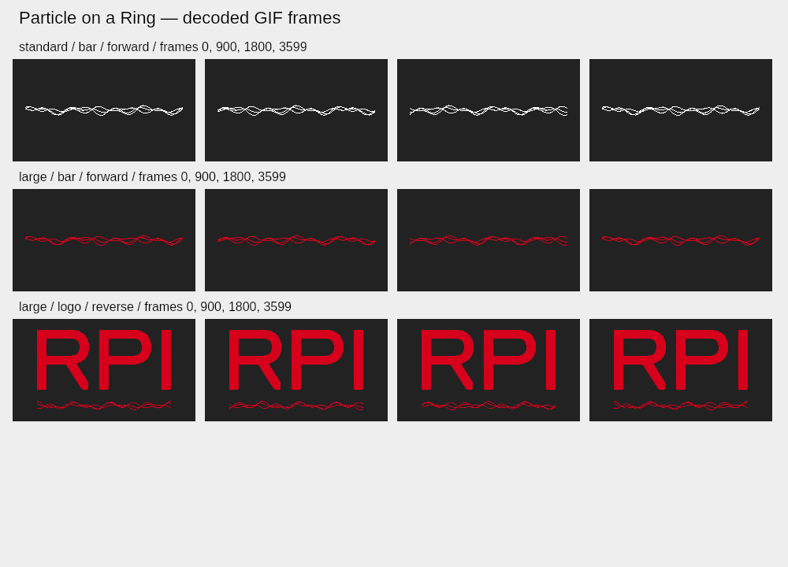

# Particle on a Ring: GIF QA

November 10, 2026. Current candidate retains published main through `492fec2`
(PR #153), including the neutral contextual theme previews/reference pairs, disclosures,
outlined Randomize die and responsive marquee behavior. Original feature `8c1e2d1`
and creative-name candidate `7a12cdf` remain preserved. No model or pattern geometry
change is made; legacy wave-quantum identifiers, URLs and saved links survive.

## Scientific name and picture

**Particle on a Ring** names the actual ideal free-particle model. Its picture is
three wavefunction phase projections, `Re(exp(iα)ψ)` at 0°, 60° and 120°, of the
normalized equal-weight periodic mode sum −4, 3, 7 with n² time evolution. The
ribbons show convention-dependent amplitude projections, not particle tracks,
probability density or measured/calibrated physical data. [Primary sources,
equations and drawing assumptions](quantum_model.md) support this identification;
no absolute certification of decorative rendering is implied.

## Default export and bounded quality policy

Default 1× now exports the **whole seamless 120-second recurrence, 3600 frames at
30 fps**. Ring-only duration/frame limits are 120 seconds/3600; Ticker, Waveform
and Gradient keep 100 seconds/3000. Every family retains the 32 MiB two-input-frame
and 64 MiB encoded guards. Nothing changes SPEED automatically. Below 1×, the
natural cycle would exceed 120 seconds; the action explains the limit before
rendering, with an explicit recovery message and no truncated/nonseamless file.

For full-logo loops longer than one minute, GIF uses Standard (1160 × 762 px).
The action visibly discloses Standard and its actual pixel dimensions before
activation; its accessible name, snapshot, progress and filename agree. Bar-only
keeps the selected Standard/Large size. Full-logo loops up to one minute likewise
keep Large if selected. The size selector/saved settings and PNG/SVG/clipboard
behavior are never changed. This trades resolution for a complete smooth loop,
with transparent background and unchanged official proportions/model coordinates.

The measured 30-second Large full logo was 20.16 MB; roughly 80 MB at 120 seconds
would exceed 64 MiB. Standard was 8.45 MB, suggesting roughly 34 MB at 120 seconds.
These are estimates motivating the policy; direct default-loop measurements are
recorded below. No silent cadence reduction, speed-up or partial-cycle export is
used. A rectangle-update alternative was rejected before publication: retaining
the lettering also retains the initial bar unless extra nonuniform-timing frames
are introduced. The shipped codec and full-frame disposal 2 remain unchanged.

Capture freezes exact live phase, speed, reverse, ink, composition, actual size
and title synchronously before yielding. First-frame phase is not reset. Current
main increases model phase with REVERSE unchecked and decreases with it checked;
GIF matches that actual source. Main preview transport and settings never change.
SVG/PNG/clipboard keep main's phase-zero policy and selected size.

## Regression and actual-byte evidence

Final full suite: **943 tests in 82 suites pass**, with no cache. All **84 inline scripts** and changed JavaScript compile, and whitespace checks pass. Focused tests cover default download requests, actual default dimensions,
resolution disclosure before activation, size/composition/speed updates, in-flight
snapshot edits, fractional speeds, encoder budget scoping, unchanged memory/file
limits, phase/direction, model polygons, timing and seam step. Full final-suite
results are recorded with the final handoff and PR.

The original 4× matrix encoded four complete 30-second GIFs, then independently
decoded all 3600 frames with exact captured-source RGBA equality on every frame.
Each contained 900 distinct frames, balanced 30/40 ms delays, repeat 0, transparent
index 0 and disposal 2. First/full-recurrence coverage was identical; the final
frame was distinct with one ordinary step to the seam. Eighty then-current
raster theme/size/composition/direction cases also passed. Historical measurements
are in [results](review-images/ring-gif/results.json).

After retaining #150, **72 current-theme default-speed raster cases** (nine themes,
both selected sizes/compositions/directions) pass exact foreground, 120-second /
3600-frame plans, distinct nearby phase and pixel-identical recurrence. Full-logo
captures consistently use Standard under the advertised policy.

The direct default-speed matrix uses real full canvases, the existing vendored
codec and the independent decoder through every frame. It compares 64 evenly
spaced full-pixel source references per GIF, including first and last, and checks
all decoded frame hashes for motion, metadata/timing and closure. The full-canvas
transparent-disposal branch of the independent test decoder now uses one bulk
clear rather than a per-pixel clear; partial-frame/palette-background behavior
is retained and existing decoder/codec tests pass. This is test throughput only.

### Direct default-speed measurements

All three actual 120-second GIFs passed full independent decoding through
**10,800 frames**. Each has 3600 distinct frames, balanced 30/40 ms delays, exact
120000 ms duration, infinite repeat, transparent index 0 and disposal 2. All 192
full-pixel source reference frames match exactly, including each first and last.
Full-recurrence raster equality and the ordinary last-to-first phase step pass.

| Selected size / composition | Actual GIF size | Canvas | Bytes | Adapter encode seconds |
| --- | --- | --- | --- | --- |
| standard / bar | standard | 1160 × 232 | 11,303,318 | 52.16 |
| large / bar | large | 2320 × 464 | 27,414,139 | 181.39 |
| large / logo | standard | 1160 × 762 | 33,795,017 | 131.97 |

The selected Large full-logo request therefore succeeds at the explicitly
advertised Standard size: **33.80 MB**, comfortably inside 64 MiB. Large bar-only
keeps its selected resolution at **27.41 MB**; Standard bar-only is **11.30 MB**.
Standard full-logo selection has the same canvas/render/codec path as this
advertised Standard rendition; snapshot and UI tests cover both selected sizes.

These are single-run serial Node adapter measurements under shared cloud load,
not browser-worker performance guarantees. Progress/cancellation stay available.
Live input bounds are 2,152,960 / 8,611,840 / 7,071,360 bytes respectively, with
at most two frames in flight; this is not a total-process memory bound. Structured
[default results](review-images/ring-gif/default-results.json) retain exact values.



The image was visually inspected. Its labels identify the **selected** size;
Large + logo uses the advertised Standard 1160 × 762 GIF. The encoding run began
before #150 reconciliation and captured its then-current white/red QA inks.
The 72 post-reconciliation raster cases separately verify all nine current
foreground mappings. Exact two-color GIF byte counts depend on palette indices,
not the foreground RGB values. Review backgrounds are not encoded in the GIF.
Only project geometry, unchanged official lettering and QA labels are published.
No user upload or outside reference image is included.

Reproduction (optional native raster QA dependency, no production dependency):

```sh
RPI_RING_GIF_SPEED=1 \
RPI_RING_GIF_CASES=standard:bar,large:bar,large:logo \
NODE_PATH=/path/to/native-canvas/node_modules:/path/to/project/node_modules \
  node scripts/quantumGifEvidence.js /tmp/rpi-ring-gif-default
```

## Reconciliation with the later shared 50 fps release

PRs #151–#153 are retained, including the thin paired dice, neutral theme previews
and 20 ms cadence for translating families. Ring export explicitly retains its
measured 30 fps default and maximum; its 120-second allowance therefore stays
3600 frames. This prevents the later shared 50 fps default from breaking default
ring export or increasing its measured budget. Ring frame plans and phase samples
exactly match measured commit `33c936e` across 48 speed/phase/direction plans and five phase samples each; renderer/model/encoder sources are byte-identical. The full combined suite passes: 943 tests in 82 suites. No cadence result
for other families is rolled back.

## Browser and release state

No browser/desktop launch, denied-launch retry, protection bypass or close/reopen
workaround is attempted. Native Node raster/codec measurements do not establish
browser-worker performance, actual download behavior, physical-device timing or
perceived smoothness. Existing progress and cancellation remain available.

PR #148 is updated on its existing branch. Serial publisher task
`01a1c648-8679-70b2-8cc1-6d9514a7c0f4` coordinates normal protected release and
Pages verification with #144. The default-product decision is resolved by the
parent: no additional user choice is pending. Preserve #144's alpha fix, this
ring budget and disclosure, and current main's unrelated UI/theme changes.
