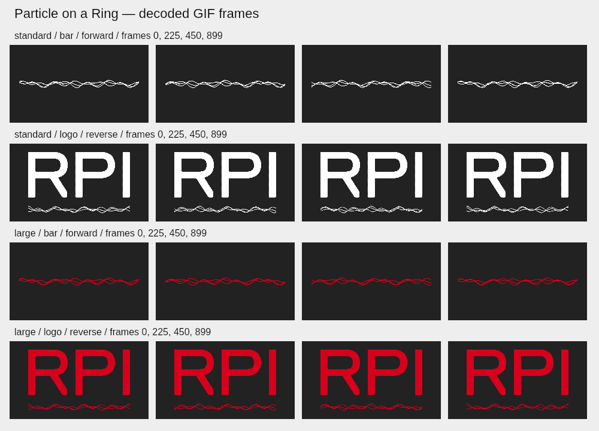

# Particle on a Ring: GIF QA

November 10, 2026. Based on published main `e19238a`; isolated branch
`codex/feat-phase-weave-gif`. The earlier Phase Weave candidate `7a12cdf` is
preserved and is not cherry-picked. The latest user correction calls for an
established scientific name, so this candidate uses **Particle on a Ring**.
The exact picture is three **wavefunction phase projections**. Sources,
equations, chosen modes and drawing limits are in [the model record](quantum_model.md).
No claim of a particle trajectory, probability-density picture, physical time
calibration or absolute certification of the decorative rendering is made.

## Behavior and compatibility

The existing GIF menu action is now available for legacy style `wave-quantum`.
Before asynchronous work, it captures exact live phase, model speed, REVERSE,
ink, composition, raster size and title. Every frame uses the same analytic
state and three fixed polygons as the preview. Live controls/playback/settings
are never changed. Natural period is `120 / SPEED` seconds. Main's actual
unchecked direction increases phase and checked REVERSE decreases it; GIF
matches that code, correcting older prose that described the opposite.

SVG/PNG/clipboard retain main's phase-zero still-image policy. Existing bar-only
and full-logo viewports, transparent padding, approved theme inks, filenames,
legacy routes, DOM/control IDs, query fields and saved share envelopes remain.
Model and bar-pattern sources byte-match the base. No production dependency or
framework is added; the optional native raster package is QA-only.

## Preserved budget and pending scope choice

The existing 100-second / 3000-frame / 32 MiB two-input-frame / 64 MiB encoded
limits are unchanged. At 30 fps, the natural 1× loop needs 120 seconds and 3600
frames; 0.2× needs 600 seconds and 18000 frames. Those requests cannot satisfy
the preserved budget. The GIF job therefore asks for SPEED ≥1.2× before renderer
allocation, without silently changing speed, reducing cadence or truncating the
cycle. The encoded-file cap can still reject especially large jobs. The user
was asked whether to extend only this model's duration/frame budget; no
affirmative answer has been received. Default 1× GIF success is **not** claimed.
The bounded export is ready for review; that product choice remains explicit.

## Automated regression evidence

- 903 tests pass in 80 suites, full run without cache.
- All 84 inline scripts and every changed JavaScript source compile.
- Whitespace validation passes.
- New tests exercise the actual speed/direction collector, exact live phase,
  forward/reverse model parity, fractional speeds, centisecond progress, final
  seam step, bar-only/full-logo model polygons, synchronous snapshot freezing
  while controls/theme/size/composition change, unchanged still output, native
  GIF action visibility and early over-budget rejection without a download.
- Existing suites retain shared state, settings/history, transport/reduced
  motion, export UI/cancellation, encoder memory/file guards and other families.

## Actual raster, codec and independent decoder

Reproducible command (optional QA environment package only):

```sh
NODE_PATH=/path/to/native-canvas/node_modules:/path/to/project/node_modules \
  node scripts/quantumGifEvidence.js /tmp/rpi-ring-gif
```

80 native raster cases cover every current theme, both sizes/compositions and
both directions at nonzero phase; recurrence at progress 1 matches progress 0
pixel-identically and a small phase step changes the raster. Four complete
30-second GIFs at the existing 4× model speed were then encoded by the shipped
vendored codec and independently decoded through all **3600 frames**. Each GIF
contains 900 distinct frames; every decoded RGBA pixel matches its captured,
palette-quantized source. Both directions and a wrap-crossing starting phase
are represented. Each GIF has exact 30000 ms duration, balanced 30/40 ms delays,
repeat 0 (infinite), transparent index 0 and disposal 2. First/full-recurrence
coverage is identical; the final frame is distinct, with one ordinary encoded
time step to the seam. There is no duplicate terminal frame.

| Export | Canvas | Bytes | Adapter encode seconds |
| --- | --- | --- | --- |
| standard / bar | 1160 × 232 | 2,825,839 | 19.89 |
| standard / logo | 1160 × 762 | 8,450,049 | 58.80 |
| large / bar | 2320 × 464 | 6,853,366 | 74.00 |
| large / logo | 2320 × 1524 | 20,161,276 | 206.19 |

Timing is one observation in a shared cloud workload using serial Node codec
adapters, not native browser workers or a performance guarantee. The live
input budget remains at most two frames (28,285,440 bytes for Large logo), not
a total-process memory bound. [Structured results](review-images/ring-gif/results.json)
contain the exact measurements.



This image was visually inspected. It contains only this project's generated
primitive geometry, existing official lettering and QA labels; no user-uploaded
screenshot or third-party reference image is published. It shows decoded frame
0, 225, 450 and 899 for each export on a dark review backdrop. The backdrop is
not encoded in the transparent GIF. Source alpha quantization is the current
main policy; queued PR #144 changes its edge policy separately and must survive
serial reconciliation.

## Reconciliation with published marquee follow-up

Published main `5f7ad20` (PR #146) is merged into this candidate. The only
conflicts were adjacent Home script references: the new scientific-name catalog
key and main's newer responsive-marquee key are both retained on both Home URLs.
All GIF/model/drawing/control source bytes match the fully decoded `8c1e2d1`
candidate, so its complete raster/codec evidence applies unchanged. Current
main's markup/CSS/runtime/test improvements and additive status section survive.
The complete combined suite passes: 912 tests in 81 suites. The initial source-only run was 903 tests in 80 suites; the extra nine tests are main’s published marquee coverage. All 84 inline scripts still compile and whitespace checks pass.

## Browser and release state

No browser launch, desktop escalation, denied launch retry or close/reopen CI
workaround was attempted. Desktop/phone layout, native keyboard interaction,
real browser downloads, viewer timing and perceived smoothness remain
unverified. These native checks do not substitute for physical-device or
formal brand approval.

Ready-PR publication and required Unit tests are recorded in the handoff/PR.
Merge/deployment remain with serial publisher task
`01a1c648-8679-70b2-8cc1-6d9514a7c0f4`, coordinated with open PR #144. Do not
merge concurrently or replace its alpha fix with this branch's older base.
