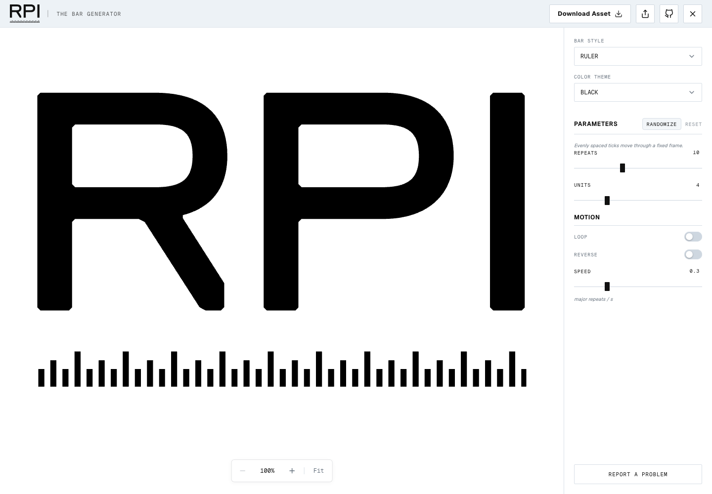
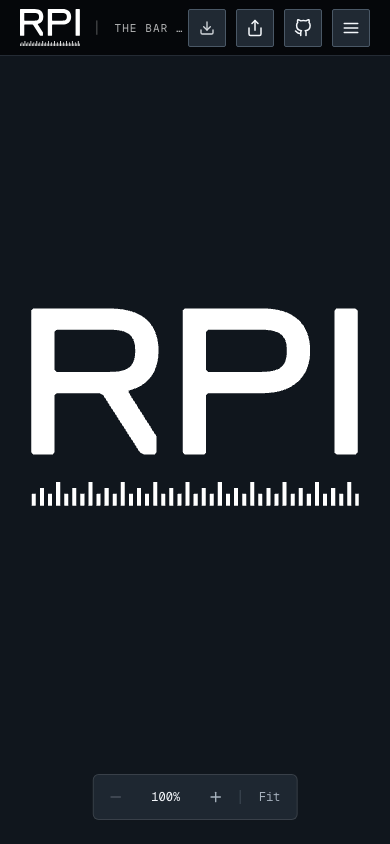
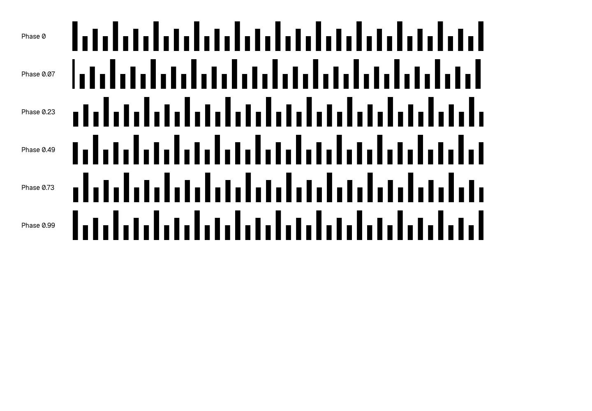

# Ruler natural edges — October 27, 2026

The owner-provided screenshot was materialized through the supported Library helper onto the MacBook Air and its actual pixels were inspected. It showed a thin fixed vertical edge beside a normal full-height tick. The repair removes only Ruler's two artificial boundary rectangles; natural clipped ticks retain their original coordinates and rhythm.

The fixed 250 × 18 viewport, y = 132.4885 placement, 21-unit letter gap, clipping, speed caps and shared render paths are retained. Natural edge whitespace is allowed for Ruler only. The control hint was updated to match.

Validation performed:

- 302 unit tests in 30 suites, including new multi-size Ruler natural-geometry/containment checks and a Ticker boundary-reference guard.
- Chromium: 86 geometry/control-range cases; 31 rendered family/variant cases and real SVG/PNG downloads, preview/header parity and two smaller layouts.
- Chromium and WebKit: each 1,296 Ruler combinations across repeats, units, speed endpoints, reverse, six phases, three color themes, desktop and mobile. SVG rectangles exactly equal the natural tick geometry; no per-frame spatial fit. Fixed geometry and page overflow checked.
- Focused Chromium live header check with motion explicitly enabled at DPR 1/2/3: moving bar frames, exact stable letter pixels, persistent DOM through eight pause/play cycles and bounded URL/export timing. The initial all-family harness timed out at a startup selector; the focused Ruler rerun passed.
- Standard/Large Ruler GIF in both engines: 40 decoded frames each, every frame checked against the captured pre-encoding coverage oracle, exact dimensions, transparency, disposal and no overflow. PNG/SVG export parity and alpha checks retained. Chromium native ImageDecoder verified first/last frames; WebKit native image decoding verified its first frame.
- Visually inspected desktop black, mobile white, desktop red in WebKit, the six-phase sheet and GIF background composites. Captures below use the final helper text.

Full temporary evidence is at `/tmp/rpi-ruler-geometry`, `/tmp/rpi-ruler-visual-chromium`, `/tmp/rpi-ruler-visual-webkit`, `/tmp/rpi-ruler-exports` and `/tmp/rpi-ruler-exports-webkit`. These local paths are review artifacts, not permanent hosted URLs. Continuous physical-display motion, hardware Safari, owner testing and institutional approval remain unverified.
