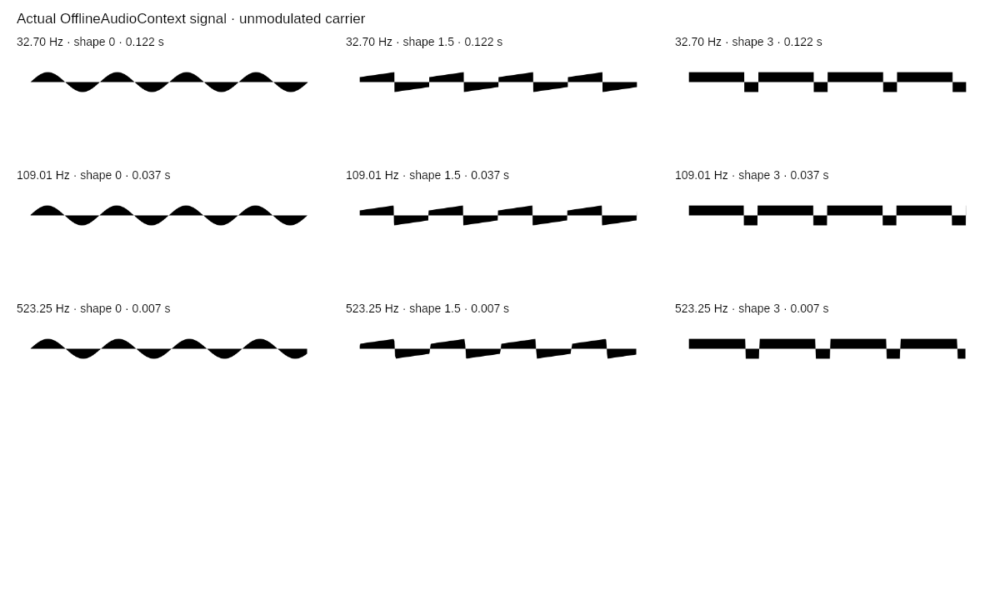

# Waveform LFO removal QA — November 11, 2026

## Requested behavior and scope

The owner requested “remove the LFO completely.” Waveform's toggle, help,
shape/rate/depth controls, logarithmic rate adapter, audio modulation stage,
visual transport, reset/randomization branches, export fields, route parameters
and optional share phase are removed. The retired helper and obsolete LFO QA
scripts are removed; historical reports remain explicitly marked as historical.

Carrier waveform/frequency, Audio, Loop, Reverse, Speed, Randomize/Reset/Undo,
actual PCM source/error status, share links and all export paths remain. Music's
separate instrument effects are not altered by this Waveform-only change.
There are no new dependencies, framework changes, brand colors or logo assets.

## Audio and scope model

Carrier oscillator gains now connect directly to the existing master output.
The independent pre-refactor carrier reference bypasses its old modulation stage
for comparison. Carrier types, morph coefficients, pitch mapping, ramp scheduling,
Pulse worklet/messages and Square fallback match exactly in mocked graph tests.
The scope still renders or records actual generated PCM, not a drawn equation.

A physical view spans four carrier periods (about 0.00764–0.12232 seconds before
sample quantization), with one carrier period per visual sweep. The speed and
reverse policy is unchanged from the former unmodulated view. One second of
fixed-size live PCM/extrema storage covers every supported window and replay
margin. No modulation-envelope branch or envelope trigger remains.

## Automated checks

Regression tests cover old query and encoded v1 share migration, absence of the
removed controls/dependency, carrier event parity, scope clock lifecycle,
actual sample ordering, fixed-axis filling, pitch edits, ring wrap, freeze,
stale render cancellation, mute/live handoff, failures and captured exports.
Existing all-family parameter action, route, export, motion, accessibility and
other behavior tests remain part of the full suite. Exact full-suite and remote
required-check results are recorded in the pull request.

## Native DSP, raster and codec checks

Run `scripts/waveformSignalLocal.js` with optional `node-web-audio-api` and
`@napi-rs/canvas` available in the execution environment. These are test-only
packages, not dependencies of the generator.

- Fifteen independent carrier PCM comparisons at frequencies 10/24/100 and
  types 0/.5/1/1.5/2 produce maximum absolute error **0**.
- Pulse's actual measured DC/RMS preserve 80% duty. Independent native worklet
  startups may differ in phase, so pulse scheduling is compared exactly in unit
  tests and duty/DC/RMS is measured separately.
- The side-tap captures 2,816 exact extrema pairs and 22,528 ordered samples;
  it changes none of the audible output samples.
- Nine actual OfflineAudioContext → captured SVG → PNG renders are nonempty.
- Six captured GIFs contain 166 frames each. All **996 decoded frames** match
  the expected indexed source pixels exactly and preserve the requested cadence.
- The contact sheet below was visually inspected. It shows four carrier cycles
  at three frequencies and three waveform shapes, with no modulation envelope.

[Native numerical results](../review-images/waveform-lfo-removal/native-results.json)

## Limits

These are source, mocked-runtime, native offline audio and raster/codec checks.
They do not establish browser responsive layout, physical keyboard/touch,
hardware-audio playback, OS clipboard/download or aesthetic acceptance. No
previously denied browser route was retried or bypassed. No formal RPI brand or
scientific approval is claimed. The removed sidebar block adds no new control,
focus target, animation, color or layout style; remaining controls keep their
existing semantics and sequence.
