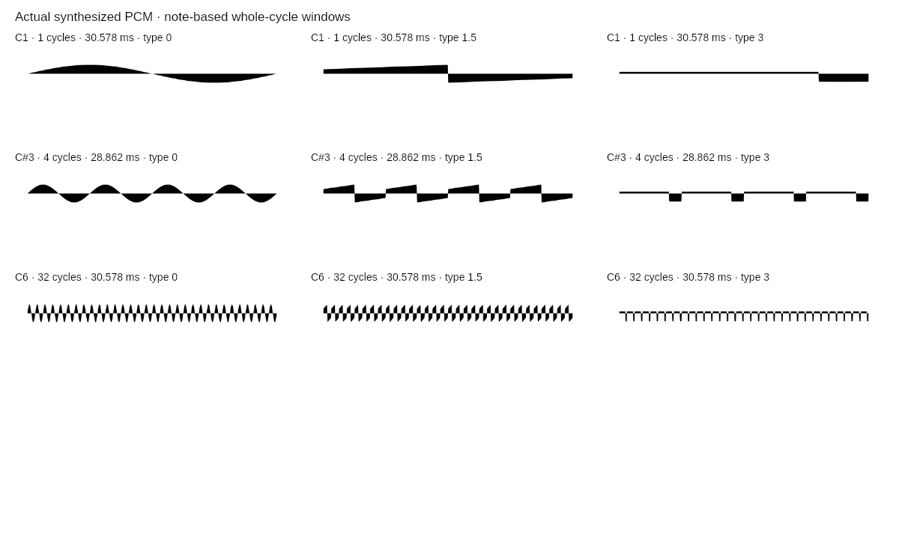

# Waveform note redesign validation — November 11, 2026

## Coverage

- Every C1–C6 chromatic note: 12-TET formula, octave ratios, immutable descriptor,
  integer cycle count and `window * frequency = cycles` within 1e-12.
- 44.1/48/96 kHz synthetic sampled sine: exact requested physical interval and
  fractional endpoints, finite output, numeric rather than forced seam closure.
- Note parsing and enharmonics, C1/C6 limits, nearest-note legacy URL/share
  migration, explicit new-note precedence, strict malformed share rejection.
- Native common start time, exact target note scheduling, no pitch glide,
  DC-free pulse coefficients, finite gain ramps, bounded coefficient reuse,
  phase-integrated stop boundaries after note changes.
- Settled live-history gate, stale asynchronous render exclusion, freeze,
  low/high pitch edits, repeated changes, ring wrap, source-label truthfulness,
  reverse sweep, immutable snapshots and error recovery.
- Existing full-repository interaction, share, route, cache, export and model
  regression suites remain required. Final counts are recorded in the PR.

## Native engine and exported files

Run `NODE_PATH=/tmp/rpi-lfo-qa/node_modules node scripts/waveformNotesLocal.js`
with optional test-only `node-web-audio-api` and `@napi-rs/canvas` installed.
Neither is a production dependency. This does not launch a browser.

All 244 combinations of 61 notes and four endpoint shapes rendered finite PCM
with the requested whole-period physical interval and the expected counted rising zero crossings. Maximum endpoint amplitude
difference was 0.000101613 for sine and 0.000428641 across these shapes, compared
with the 0.1 carrier gain scale. This reflects native/Float32 and fractional
sample reconstruction, not an intentionally altered phase or forced endpoint.
It is evidence for this engine/run, not a universal browser tolerance guarantee.

Nine actual audio → shared SVG → native PNG exports were nonempty and inspected
in the contact sheet. They include C1 (1 cycle), C#3 (4 cycles) and C6 (32 cycles),
with Sine, a Saw/Square morph, and Pulse. Six GIFs were decoded frame by frame;
all 996 decoded RGBA frames matched their corresponding expected indexed source
pixels. All preserve the requested visual sweep/cadence plan. This is a codec
and geometry check, not a claim of physically exact GIF playback timing.

The local warm-cache example was about 156 ms cold and 1.32 ms warm. Do not use
these single-run numbers as a portable browser performance guarantee.

[Detailed numerical/export results](../review-images/waveform-notes/results.json)

## Remaining limits

The automated suite and native engine do not establish responsive browser
layout, keyboard/mobile-touch behavior on a physical device, hardware audible
pitch/timbre, OS export/clipboard delivery or user aesthetic acceptance.
Previously unavailable/denied browser routes were not bypassed. Browser timing
and native implementations can differ. The app is not a calibrated scientific
instrument and claims no literal 100% analog accuracy or formal RPI approval.
The mathematical contract and the numerical limits are both documented in
[the model guide](waveform_notes.md).
