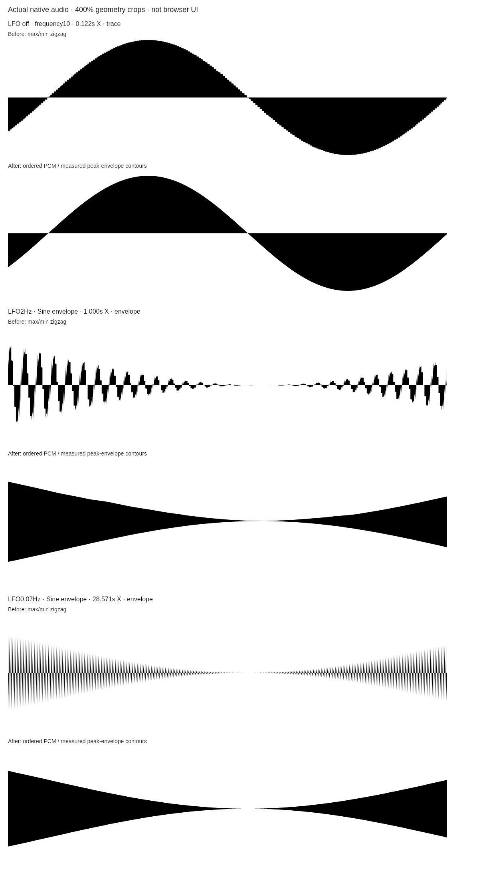
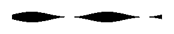

# Scope contours and LFO playback QA — November10,2026

## Two distinct diagnoses

The supplied private screenshot was inspected locally via Library. It shows
400% zoom, frequency10, LFO off, LOOP off/frozen and a .122s window. Its teeth
come from drawing each bin's maximum and minimum at identical X, then joining
that zigzag to the baseline. It does not itself demonstrate LFO motion.
The owner's separate LFO-motion complaint is explained by #163 scanning only
one fastest/carrier period: across a slow envelope this barely travels.
The screenshot is not republished.

## Corrected representation and motion

Sparse views retain ordered actual PCM. Linear interpolation between adjacent
PCM samples supports fractional offsets and removes eight-sample stepping.
Dense slow-LFO views show a labeled measured peak envelope, with upper and lower
contours separately and bounded monotone interpolation between measured peaks.
This is a statistical envelope representation, not a fabricated instantaneous
carrier. Its bins span approximately one real carrier period, capped at1024.
The mode uses actual carrier density: over16cycles with LFO below carrierHz/8;
high-rate modulation retains PCM. Fixed gain and physical X do not change.

Active LFO playback scans one LFO period in1/SPEED display seconds; with
modulation disabled/zero depth it scans one carrier period. The default two-LFO-
cycle window moves half its width per3.333s visual cycle. Triggering comes from
actual envelope-level or PCM crossings. SPEED/reverse/freeze/export use the
same immutable recording. Live capture continues; refresh occurs between visual
sweeps and after edits/history transitions, with existing mixed-history labels.
A refreshed actual capture can change the outline. Noncommensurate signals can
reset at the replay boundary; it is not a claim of seamless real-time playback.

The silent tap sends ordered PCM and eight-sample extrema together and produces
zero output. Long history stores extrema only; one second of full PCM covers
all sparse-window/playback/trigger margins. At48kHz the live rings total roughly
2.8MiB, rather than storing full-rate PCM for the whole57.143s history. Dense
silent renders release PCM after reduction. Audible graph/routing is unchanged.

## Evidence

- Final full Jest:1049tests/91suites. New contour tests cover smooth ordered
  400% sine with exactly eight turning points over four carrier cycles,
  fractional-sample motion, exact source-time X, bounded independent contours,
  visible .07/2Hz envelope travel, high-rate PCM, freeze and one-second ring
  wrap/slow-to-sparse reconfiguration. Existing history/audio/export tests remain.
- `scripts/waveformSignalLocal.js`:90original/shared native PCM comparisons,
  maxerror0;42actual AM-product cases, max3.725290298461914e-9;2816exact extrema
  pairs plus22528exact ordered PCM samples; unchanged audible output.
-24actualPNG exports and8GIFs/1328decoded frames match independently prepared
  expected palette/alpha pixels. All166frames differ in .07/2Hz cases;
  high-rate1300Hz has at most one duplicate. Existing50fps target, centisecond
  cadence, frame/resource guards and straight-alpha edges are preserved.
- `scripts/waveformScopeContoursLocal.js` compares identical actual native PCM
  using the original #163 geometry/bin resolution and the corrected geometry,
  at true400% scale with preserved aspect. It does not use an ideal sine.
- Changed-script/inline-script syntax, route caches and whitespace pass.

Browser reload and one normal recovery timed out; no denied escalation was
retried. This patch does not claim rendered live browser, hardware listening,
physical Safari/iOS, autoplay-denial, touch or OS download verification. Native
rasters/codec evidence does not establish browser equivalence or brand approval.

## Owner live checklist

1. Warm reload; frequency10/Sine/LFOoff. At400% the curve should have smooth
   contours without bin-local teeth. Freeze and compare SVG/PNG.
2. LFOon at.07/2Hz should visibly travel, not remain almost stationary. Check
   25/100% depth and Sine/Saw/Square/Pulse shapes; caption says peak envelope.
3. High100/1300Hz modulation uses PCM detail. Compare SPEED.2×/1×/4×, Reverse
   and LOOP with Audio off/on. Audio pitch and modulation should sound unchanged.
4. Repeated edits retain fixed X and truthful mixed-history/filling labels.
   Freeze/edit/mute holds the exact frame. GIF begins there in the selected
   direction/speed; later edits do not alter the captured recording.
