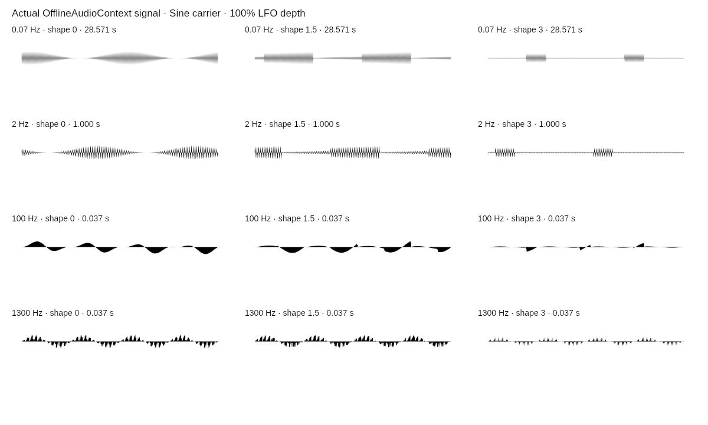
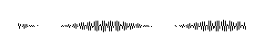

# Scope playback repair QA — November 10, 2026

Production default was visibly inspected in the permitted cloud browser at
`generator/waveform/`: .037s offline audio view; starting Audio selected live
capture with the same physical window; stopping it restored the offline source.
The browser did not verify the patched deployment. No denied browser escalation
was retried and hardware listening, physical Safari/iOS, autoplay denial,
responsive controls and OS downloads remain unverified for this patch.

## Diagnosis and behavior

The old preview advanced one recorded second per display second despite its
millisecond X window. Live packets independently replaced the window, ignoring
SPEED entirely. The repair retains real PCM, bounded continuous history and
physical X coverage, then plays immutable triggered sample sweeps at the chosen
visual speed. The default 0.3 visual cycles/s takes 3.333s per sweep. At most one
cycle of the fastest carrier/active LFO detail is scanned, preventing hundreds
of apparent carrier cycles/s. Live snapshots refresh between sweeps and after
edits/filling/mixed-history completion; they are labeled as slowed sample sweeps.
This deliberately trades real-time scrolling for readable recorded playback.
Native audible graph, LFO shape/depth/rate and master routing are untouched.

## Automated evidence

- `tests/waveformScopeMotion.test.js`: 108 carrier/LFO enabled/rate/depth
  combinations; actual-source trigger and forward/reverse samples; all motion
  speed endpoints; GIF display durations; live motion without new packets;
  packet jitter independence, freeze and immutable exports after edits.
- Existing transition tests retain continuous history, fixed partial X, long
  buffers, repeated edits, disabled LFO, frozen/mute/offline handoffs and errors.
- Full Jest: **956 tests / 87 suites** pass.
- Native `scripts/waveformSignalLocal.js`: **90** original/shared audio PCM
  comparisons, maximum error **0**; **42** actual post-gain AM-product cases,
  maximum error **3.725290298461914e-9**; **2816** exact live-worklet extrema
  pairs with unchanged audible output; **24** actual PNGs and **six** slowed
  GIFs / **996** decoded frames with exact expected palette/alpha pixels.
- Changed scripts and inline scripts parse; whitespace and route cache checks
  pass. No new production dependency or audio node is introduced.

The images contain only permitted project output, rendered from actual native
OfflineAudioContext samples. The GIF is the real encoder output at the default
visual speed, without a duplicated endpoint. Noncommensurate signal content
can reset at the replay boundary. Review images do not establish browser or
hardware-audio equivalence or formal brand approval.

## Owner live checklist after deploy

1. Warm reload Waveform; LFO off should move calmly at default speed rather
   than race. Compare 0.2× / 1× / 4× and Reverse with Audio off and on.
2. Test slow .07/2Hz and high 1300Hz LFO, all shapes/depths. Physical window
   stays labeled; slow windows fill only the recorded region.
3. Change frequency, shape/depth/rate repeatedly. Existing real history stays
   at fixed X scale and mixed settings are labeled; new capture can replace
   the envelope between sweeps without inventing a blend.
4. Turn LOOP off, edit and toggle Audio. Shown frame and SVG/PNG stay frozen.
   Resume, export GIF; it begins at the shown frame/direction and uses the
   selected visual speed, while later edits leave that export immutable.
